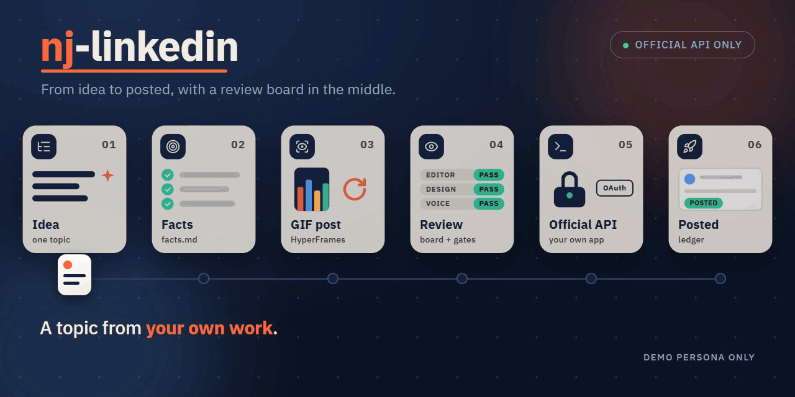
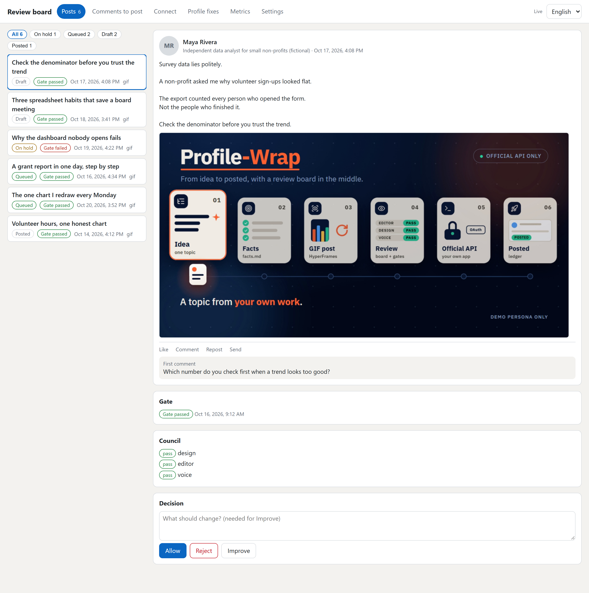

<div align="center">



# Profile-Wrap

### Free, open-source LinkedIn post manager

## Your LinkedIn, on autopilot. You stay the boss.

[](https://github.com/NJ-Burrito/Profile-Wrap/actions/workflows/ci.yml)
[](LICENSE)
[](https://pypi.org/project/profile-wrap/)
[](docs/PLATFORMS.md)
[](.claude-plugin/plugin.json)
[](docs/GATES.md)
[](https://github.com/NJ-Burrito/Profile-Wrap/stargazers)
[](https://nj-burrito.github.io/Profile-Wrap/)

**Profile-Wrap is a free, open-source LinkedIn post manager and scheduler.**
It plans your week of posts, writes them in your voice and checks each one.
**Nothing goes out until you tap Allow.**

[**⬇️ Download the free app**](https://github.com/NJ-Burrito/Profile-Wrap/releases/latest) · [🌐 Website](https://nj-burrito.github.io/Profile-Wrap/) · [📦 PyPI](https://pypi.org/project/profile-wrap/)

### Pick how you want it. All free. 👇

| 🧩 Plugin | 🧠 Skills | 🔌 MCP server | 🖥️ Desktop app |
|:---:|:---:|:---:|:---:|
| For **Claude Code** and **Codex** | For any AI agent that reads skills | For any app that speaks MCP | No AI app? Use this |
| [Install ↓](#plugin) | [Install ↓](#skills) | [Install ↓](#mcp) | [Download ↓](#app) |

</div>

## 3 steps (any of the four)

1️⃣ **Install** it

2️⃣ **Ask** for your week of posts

3️⃣ **Tap Allow** on each post you like

That is all.

Stuck? [Step-by-step guide with pictures of what you will see](docs/INSTALL-DESKTOP.md)



👆 Your board. Allow, Reject or Improve. Every post waits here until you say go.

<a id="plugin"></a>

## 🧩 Plugin

Needs [uv](https://docs.astral.sh/uv/) once: `uv tool install profile-wrap`

Claude Code, type these two lines:

```
/plugin marketplace add NJ-Burrito/Profile-Wrap
/plugin install profile-wrap@profile-wrap
```

Codex: `codex plugin marketplace add NJ-Burrito/Profile-Wrap` ([Codex guide](docs/CODEX.md)).

Then say: **"set up Profile-Wrap"**. Claude Code gets 5 skills, 6 commands and the MCP server in one go.

<a id="skills"></a>

## 🧠 Skills

5 skills: **setup**, **plan**, **write**, **visuals**, **ship**.

Get them on [Smithery](https://smithery.ai/skills/naderalzghoulbusiness), or copy the [`.agents/skills`](.agents/skills) folder into your agent.

<a id="mcp"></a>

## 🔌 MCP server

8 tools: check your setup, see your calendar, draft a post, check facts, read your board, and post only what you allowed. Needs [uv](https://docs.astral.sh/uv/).

```
claude mcp add profile-wrap -- uvx profile-wrap-mcp
```

Other apps: [MCP guide](docs/MCP.md). Also on the [MCP Registry](https://registry.modelcontextprotocol.io) and graded A on mcprush:

[](https://mcprush.com/to/profile-wrap-mcp?ref=badge)

<a id="app"></a>

## 🖥️ Desktop app

[🪟 Windows](https://github.com/NJ-Burrito/Profile-Wrap/releases/latest) · [🍎 Mac (Apple chip)](https://github.com/NJ-Burrito/Profile-Wrap/releases/latest) · [💻 Mac (Intel chip)](https://github.com/NJ-Burrito/Profile-Wrap/releases/latest) · [🐧 Linux](https://github.com/NJ-Burrito/Profile-Wrap/releases/latest)

Not sure which Mac you have? Click the Apple menu, then About This Mac.

## What it does for you

📅 Plans your week of posts

✍️ Writes them in your voice

🔑 Uses your own ChatGPT, Claude or Gemini account

✅ Checks every post before it goes out

👀 Shows you each one first. You approve.

⏰ Posts at a good time

🌍 Works in English and Arabic

🔎 Optional readers can list a person's recent posts (details in docs/PROVIDERS.md). They use two free tools (Apify and Tavily), then public pages. All are off by default, and you accept the risk of each one yourself.

## Is it safe?

🔒 It uses LinkedIn's official API, through your own free developer app ([setup guide](docs/linkedin-app-setup.md))

🙈 It never asks for your LinkedIn password

📭 It never reads your private messages

🛑 Nothing goes out unless you tap Allow

🆓 Free, and you can stop it any time

## Profile-Wrap and other LinkedIn post tools

What it costs to start, from each tool's own pricing page (checked 24 October 2026; prices change, check the source).

| Tool | 💵 Cost to start | 🆓 Free option |
|---|---|---|
| **Profile-Wrap** | $0 | Free and open source (MIT) |
| Buffer | From $5 a month ([pricing](https://buffer.com/pricing)) | Free plan |
| AuthoredUp | $16.63 a month, billed yearly ([pricing](https://authoredup.com/pricing)) | Free trial |
| Taplio | $39 a month ([pricing](https://taplio.com/pricing)) | Free trial |
| Postiz | Free to self-host ([repository](https://github.com/gitroomhq/postiz-app)) | Open source (AGPL-3.0) |

✨ What sets Profile-Wrap apart: it runs on your own computer or inside your AI app (Claude Code, Codex, or any app that speaks MCP), and every post waits on your board until you tap Allow.

## Questions

**What is Profile-Wrap?**
A free, open-source LinkedIn post manager and scheduler. It plans your week of posts, writes them in your voice and checks each one. You tap Allow on the posts you like. It is software for LinkedIn, not related to woodworking machines with a similar name.

**Is it free?**
Yes. The app is free. Writing uses your own AI account (ChatGPT, Claude, Gemini, or a free local one).

**Do I need to code?**
No. Install, ask, tap. That is it.

**Which one should I pick?**
Use Claude Code or Codex? Take the plugin. Another AI app? The MCP server. None? The desktop app.

**Mac or Windows?**
Both. Linux too.

**Arabic?**
Yes. Arabic and English, side by side.

**What if I don't like a post?**
Tap Reject, or ask for a better one. Nothing posts without you.

**Is it made by LinkedIn?**
No. It is an independent project by [Nader Alzghoul](https://www.linkedin.com/in/nader-alzghoul), a QA automation engineer.

## بالعربية

**Profile-Wrap** مدير منشورات لينكدإن مجاني ومفتوح المصدر. يخطط منشورات أسبوعك، ويكتبها بأسلوبك، ويفحص كل منشور قبل نشره. لا يُنشر شيء حتى توافق عليه بنفسك. يعمل بالعربية والإنجليزية، على ويندوز وماك ولينكس.

[⬇️ حمّل التطبيق المجاني](https://github.com/NJ-Burrito/Profile-Wrap/releases/latest)

<br>

[For developers →](docs/FOR-DEVELOPERS.md) · More from NJ: [NJ-Kit](https://nj-burrito.github.io/NJ-Kit/) · [QA-Wrap](https://nj-burrito.github.io/QA-Wrap/) · [Portfolio](https://nj-burrito.github.io/)

Profile-Wrap is not affiliated with or endorsed by LinkedIn. Free and open source under the [MIT licence](LICENSE).
