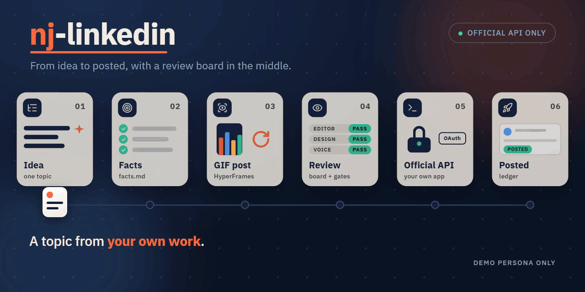
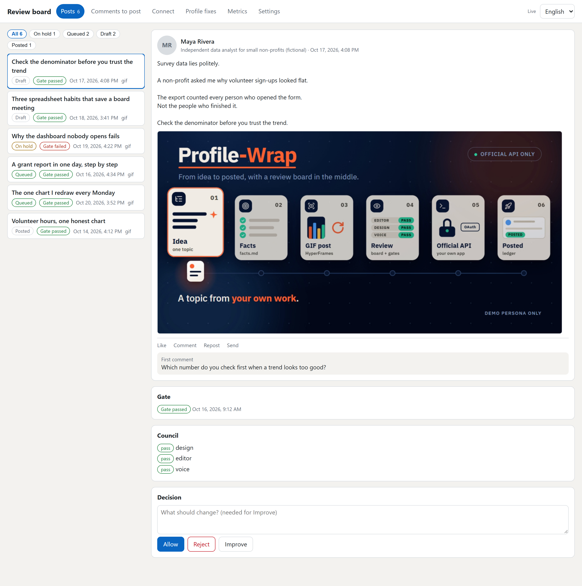

<div align="center">



# Profile-Wrap

## Your LinkedIn week, drafted and checked. You approve.

**Free post manager. You stay the boss.**

- ✍️ **Writes your week of posts** in your voice
- ✅ **Checks every post** before it can go out
- 🔒 **Nothing is posted until you tap Allow**

[**⬇️ Download the free app**](https://github.com/NJ-Burrito/Profile-Wrap/releases/latest)

</div>

---

[](https://github.com/NJ-Burrito/Profile-Wrap/actions/workflows/ci.yml)
[](LICENSE)
[](https://pypi.org/project/profile-wrap/)
[](docs/PLATFORMS.md)
[](.claude-plugin/plugin.json)
[](docs/GATES.md)
[](https://github.com/NJ-Burrito/Profile-Wrap/stargazers)
[](https://nj-burrito.github.io/Profile-Wrap/)

**Profile-Wrap is a free, open-source LinkedIn post manager, made by [Nader Alzghoul](https://nj-burrito.github.io/) (NJ-Burrito).**
It plans your week of posts, writes them in your voice and checks each one.
[🌐 Website](https://nj-burrito.github.io/Profile-Wrap/) · [📦 PyPI](https://pypi.org/project/profile-wrap/)

### What you need first

Profile-Wrap is free, but setup takes a few steps. This is the full list.

**No account needed**
- 👀 The offline demo: a made-up account, a real review board. Nothing leaves your computer.
- 📋 Copy mode is where every new workspace starts: Profile-Wrap drafts the post, the gate checks it, you copy it (`profile-wrap copy <draft>`, or the Copy button in the desktop app) and paste it into LinkedIn yourself. No LinkedIn developer app and no token. You still need a writing helper (below).

**A writing helper (pick one)**
- Claude Code, with its `claude` command installed
- A paid key from an AI provider (Anthropic, OpenAI, OpenRouter or Gemini). You pay that provider
- Ollama, a free model that runs on your computer

A ChatGPT or Claude chat subscription is not a key and does not work on its own. [All providers](docs/PROVIDERS.md).

**To post from Profile-Wrap (optional, you opt in later)**
- A free LinkedIn developer app that you create yourself, a LinkedIn Page you manage (LinkedIn's form may ask for one), and one redirect address. Plan for roughly 15 minutes. That time is a guess, not measured.
- Sign in again about every 60 days. There is no refresh.
- Guided, with a check at every step and your re-sign-in date: the **Connect LinkedIn** screen in the desktop app, or `profile-wrap auth connect` in a terminal (English or Arabic). It never asks for your LinkedIn password.
- Written steps: [LinkedIn app setup](docs/linkedin-app-setup.md)
- Existing workspaces keep the posting mode they already have; nothing is switched for you.

**Good to know**
- The desktop app has a Connect LinkedIn screen in English and Arabic (the new screens carry both; the older ones are English for now).
- The desktop app writes **text drafts only**. Slides and GIFs need the command line (`build-week`) plus Node 22 or newer, Chrome and ffmpeg ([details](docs/GUI.md)).
- The downloads are unsigned, so your computer will warn you once ([how to open them](docs/INSTALL-DESKTOP.md)).

### Pick how you want it. All free. 👇

| 🧩 Plugin | 🧠 Skills | 🔌 MCP server | 🖥️ Desktop app |
|:---:|:---:|:---:|:---:|
| For **Claude Code** and **Codex** | For any AI agent that reads skills | For any app that speaks MCP | Text drafts only. No Claude Code needed |
| [Install ↓](#plugin) | [Install ↓](#skills) | [Install ↓](#mcp) | [Download ↓](#app) |

<a id="plugin"></a>

## 🧩 Plugin

Needs [uv](https://docs.astral.sh/uv/) once: `uv tool install profile-wrap`

Claude Code, type these two lines:

```
/plugin marketplace add NJ-Burrito/Profile-Wrap
/plugin install profile-wrap@profile-wrap
```

Codex: `codex plugin marketplace add NJ-Burrito/Profile-Wrap` ([Codex guide](docs/CODEX.md)).

Then say: **"set up Profile-Wrap"**. Claude Code gets 5 skills, 6 commands and the MCP server in one go.

<a id="skills"></a>

## 🧠 Skills

5 skills: **setup**, **plan**, **write**, **visuals**, **ship**.

Get them on [Smithery](https://smithery.ai/skills), or copy the [`.agents/skills`](.agents/skills) folder into your agent.

<a id="mcp"></a>

## 🔌 MCP server

8 tools: check your setup, see your calendar, draft a post, check facts, read your board, and post only what you allowed. Needs [uv](https://docs.astral.sh/uv/).

```
claude mcp add profile-wrap -- uvx profile-wrap-mcp
```

Other apps: [MCP guide](docs/MCP.md). Also on the [MCP Registry](https://registry.modelcontextprotocol.io) and graded A on mcprush:

[](https://mcprush.com/to/profile-wrap-mcp?ref=badge)

<a id="app"></a>

## 🖥️ Desktop app

[🪟 Windows](https://github.com/NJ-Burrito/Profile-Wrap/releases/latest) · [🍎 Mac (Apple chip)](https://github.com/NJ-Burrito/Profile-Wrap/releases/latest) · [💻 Mac (Intel chip)](https://github.com/NJ-Burrito/Profile-Wrap/releases/latest) · [🐧 Linux](https://github.com/NJ-Burrito/Profile-Wrap/releases/latest)

Not sure which Mac you have? Click the Apple menu, then About This Mac.

## 3 steps (any of the four)

1️⃣ **Install** it

2️⃣ **Ask** for your week of posts

3️⃣ **Tap Allow** on each post you like

That is all.

Stuck? [Step-by-step guide with pictures of what you will see](docs/INSTALL-DESKTOP.md)



👆 Your board. Allow, Reject or Improve. Every post waits here until you say go.

## What it does for you

📅 Plans your week of posts

✍️ Writes them in your voice

🔑 Writes with your own AI helper: Claude Code, a provider key or a free local model

✅ Checks every post before it goes out

👀 Shows you each one first. You approve.

⏰ Suggests a good time for each post. Timed posting is optional and sits in a grey area of LinkedIn's rules, so read docs/TERMS-AND-RISK.md first

🌍 Works in English and Arabic

🔎 Optional readers can list a person's recent posts (details in docs/PROVIDERS.md). They use two free tools (Apify and Tavily), then public pages. These do not use LinkedIn's official way in and may break LinkedIn's rules. All are off by default, and you accept the risk of each one yourself.

## Is it safe?

🔒 For posting, it uses LinkedIn's own official way in, through your own free LinkedIn app ([setup guide](docs/linkedin-app-setup.md))

🙈 It never asks for your LinkedIn password

📭 It never reads your private messages

🛑 Nothing goes out unless you tap Allow

🆓 Free, and you can stop it any time

## Profile-Wrap and other LinkedIn post tools

What it costs to start, from each tool's own pricing page (checked 24 October 2026; prices change, check the source).

| Tool | 💵 Cost to start | 🆓 Free option |
|---|---|---|
| **Profile-Wrap** | $0 | Free and open source (MIT) |
| Buffer | From $5 a month ([pricing](https://buffer.com/pricing)) | Free plan |
| AuthoredUp | $16.63 a month, billed yearly ([pricing](https://authoredup.com/pricing)) | Free trial |
| Taplio | $39 a month ([pricing](https://taplio.com/pricing)) | Free trial |
| Postiz | Free to self-host ([repository](https://github.com/gitroomhq/postiz-app)) | Open source (AGPL-3.0) |

✨ What sets Profile-Wrap apart: it runs on your own computer or inside your AI app (Claude Code, Codex, or any app that speaks MCP), and every post waits on your board until you tap Allow.


## Questions

**What is Profile-Wrap?**
A free, open-source LinkedIn post manager. It plans your week of posts, writes them in your voice and checks each one. You tap Allow on the posts you like. It is software for LinkedIn, not related to woodworking machines with a similar name.

**Is it free?**
Yes. The app is free. Writing uses an AI helper you set up: Claude Code, a key from an AI provider (the provider may charge you), or a free local model.

**Do I need to code?**
You do not write code. You do set up a few accounts and keys first, see What you need first above. After setup, daily use is: ask, check, tap.

**Which one should I pick?**
Use Claude Code or Codex? Take the plugin. Another AI app? The MCP server. None? The desktop app (text drafts only).

**What if I don't like a post?**
Tap Reject, or ask for a better one. Nothing posts without you.

**Is it made by LinkedIn?**
No. It is an independent project by [Nader Alzghoul](https://www.linkedin.com/in/nader-alzghoul), a QA automation engineer.

## بالعربية

**Profile-Wrap** مدير منشورات لينكدإن مجاني ومفتوح المصدر. يخطط منشورات أسبوعك، ويكتبها بأسلوبك، ويفحص كل منشور قبل نشره. لا يُنشر شيء حتى توافق عليه بنفسك. يعمل بالعربية والإنجليزية، على ويندوز وماك ولينكس.

[⬇️ حمّل التطبيق المجاني](https://github.com/NJ-Burrito/Profile-Wrap/releases/latest) · [الصفحة العربية الكاملة](https://nj-burrito.github.io/Profile-Wrap/ar/)

<br>

[For developers →](docs/FOR-DEVELOPERS.md) · More from NJ: [NJ-Kit](https://nj-burrito.github.io/NJ-Kit/) · [QA Wrap](https://nj-burrito.github.io/QA-Wrap/) · [Business-Wrap](https://nj-burrito.github.io/Business-Wrap/) · [Portfolio](https://nj-burrito.github.io/)

Profile-Wrap is not affiliated with or endorsed by LinkedIn. Free and open source under the [MIT licence](LICENSE).
