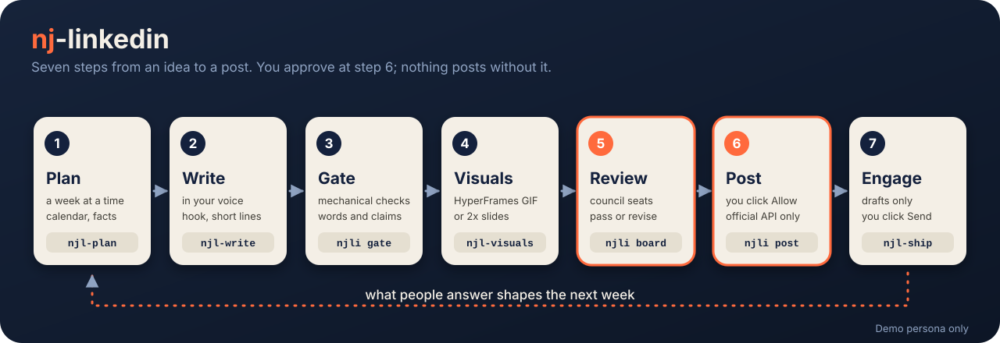

<div align="center">

# Profile-Wrap for developers

The plain-language front page is the [README](../README.md). This page is the technical one.

**Plan, write, check and ship LinkedIn posts from Claude Code, inside LinkedIn's terms.**

[](https://github.com/NJ-Burrito/profile-wrap/actions/workflows/ci.yml)
[](../LICENSE)
[](../pyproject.toml)
[](PLATFORMS.md)
[](../.claude-plugin/plugin.json)
[](GATES.md)


</div>

## What it does

✍️ Writes posts in your voice, in English, Arabic or both as a pair.
🔢 Checks every number against facts you verified yourself. No fact, no number.
🧪 Runs deterministic gates: slop words, private terms, Arabic hygiene, links, hashtags.
🎞️ Builds slides and looping GIFs (optional, needs Node and ffmpeg).
🗓️ Plans the week, picks a posting minute inside your audience window, skips holidays.
👀 Shows every draft on a local review board. You press Allow.
🚀 Posts through the official LinkedIn API, with your own developer app.
🛑 Pauses everything with one command.



It is a Claude Code plugin and a plain command line (`profile-wrap`). The Python core uses only the standard
library. Without Claude, without Node and without a LinkedIn app it still runs the demo, the gates
and the board.

## Pick how you use it

| You are | Use | Start here |
|---|---|---|
| 🖥️ Anyone, no terminal | the desktop app (Windows, macOS, Linux) | download from [Releases](https://github.com/NJ-Burrito/profile-wrap/releases), then [docs/INSTALL-DESKTOP.md](INSTALL-DESKTOP.md) |
| 🔑 Any AI provider | Anthropic, OpenAI, OpenRouter, Gemini, Ollama or your own Claude Code | the app's Providers screen, or [docs/PROVIDERS.md](PROVIDERS.md) |
| 🧩 Claude Code user | the plugin | `/plugin marketplace add NJ-Burrito/profile-wrap` |
| 🧩 Codex user | the Codex plugin and skills | [docs/CODEX.md](CODEX.md) |
| 🔌 Any MCP client | `profile-wrap-mcp` | [docs/MCP.md](MCP.md) |
| ⌨️ Terminal | the `profile-wrap` command | the quickstart below |

## Quickstart (5 minutes)

You need Python 3.10 or newer. Nothing else.

**1. Install.**

```bash
uv tool install profile-wrap        # or: pipx install profile-wrap
```

Not on PyPI for you yet? Use `uv tool install git+https://github.com/NJ-Burrito/profile-wrap`. As a Claude
Code plugin: `/plugin marketplace add NJ-Burrito/profile-wrap`, then `/plugin install profile-wrap@profile-wrap`.

**2. Try it on a fictional person. No account, no network, no model.**

```bash
profile-wrap init --demo --yes
profile-wrap demo run
```

`demo run` walks one whole fictional week for Maya Rivera: the gates (one fails on purpose), the review
board, Allow, a post to a fake LinkedIn on your own machine, `due`, a draft and a comment from a fake
`claude`, the scheduler preview and the leak scan. It takes about half a minute and exits 0 when every
step passed. Maya, her client and her links are invented.

**3. Make it yours.**

```bash
profile-wrap doctor                          # what your machine can do, with the install line for your OS
profile-wrap init --express                  # 7 questions, then sensible defaults
profile-wrap facts add --claim "Cut the weekly review to 30 minutes" --numbers "30 minutes" --source notes/review.md
profile-wrap facts verify F01 --evidence notes/review.md     # only you, in a terminal
profile-wrap calendar fill --weeks 1
profile-wrap build-week --dry-run
```

In Claude Code, say "set up LinkedIn" or run `/profile-wrap:setup`. The interview resumes where it
stopped. A first real draft needs no LinkedIn app: copy mode gives you a block to paste.

**4. Connect your own LinkedIn app (optional, when you want posting).** Follow
[docs/linkedin-app-setup.md](linkedin-app-setup.md), then `profile-wrap auth` and `profile-wrap selftest`. Posting
stays click-to-send: you press Allow on the board, then `profile-wrap post <slug> --now`.

More detail: [QUICKSTART.md](../QUICKSTART.md).

## How it keeps you inside LinkedIn's terms

Profile-Wrap is built so the unsafe actions have no code path. It cannot promise how LinkedIn treats
your account. Read [docs/TERMS-AND-RISK.md](TERMS-AND-RISK.md) first.

| Rule | What the code does |
|---|---|
| ✅ Official API only | Only `profile_wrap/linkedin/` talks to LinkedIn, on an endpoint allowlist. `profile-wrap compliance lint` runs in tests, CI and `doctor`. |
| ✅ Your own developer app | Your keys, your token, stored in your config folder with user-only permissions. Nothing is shared. |
| ✅ A human clicks | The default is click mode: Allow on the board, then Post now. Unattended posting is opt-in, behind a typed acknowledgement bound to the text hash. |
| 🚫 No scraping, no login | No browser against linkedin.com, no cookies, no password. A shared password is never needed, stored or used. |
| 🚫 No DMs | Messages and the inbox are never read. |
| 🚫 No invites | LinkedIn's invitation API is partner-only. The package drafts a short shortlist; you click Connect. |
| 🚫 No disguise | Nothing pretends automation is a person. Posting-time spread is an audience-window and spacing policy, documented as such. |
| 📏 Caps that config cannot raise | At most 7 posts a week, 1 per run, 12 hours between posts at the very least (20 by default), 10 comments and replies a day, 5 connect slots, notes up to 200 characters, 60 seconds between actions. Defaults are lower: 3 posts a week. |
| 🛑 Stops on 403 and 429 | A refusal from LinkedIn stops the run; it is not retried in a loop. |
| 🧾 Ledger first | A post is written to the ledger before it is sent; a post that may or may not be live becomes `needs_check` and is never resent on its own. |
| ⏸️ Kill switch | `profile-wrap pause --all` stops every job and API call. Every job checks the flag first. |

The fact gate is a traceability guarantee, not a truth guarantee: it proves each number came from a
fact you verified, not that the fact is true.

## Reading other people's posts (Apify, Tavily, public)

`engagement.reading.providers` takes any subset of `["apify", "tavily", "public"]`, in that order (`public` last). Each
needs its own typed acknowledgement (`profile-wrap config ack apify|tavily|public`); `config.effective_modes` drops a
provider whose acknowledgement is missing or stale and lists it in `notes`, and returns the live order as
`reading_chain`. `profile_wrap/linkedin/readers.py` holds the code: `build_chain(cfg, workspace)` returns a
`ReadingChain`; `chain.profile_posts(target)` gives `{posts, source, notes, clean_empty}` and
`chain.fill_text(posts)` fetches full text for Tavily-found posts, one URL per call; a bought text is kept in the search cache. The command `profile-wrap read posts <profile-url> [--json] [--text]` runs this chain for one person (it respects acknowledgements, pacing and ledgers, and exits 1 when no reader is switched on or none could answer). Pacing (Apify: credit left at the
start of the day over the days left in the billing cycle; Tavily: 1,000 credits minus a 100 reserve over the days left in
the calendar month) and the state files (`data/apify_budget.json`, `data/tavily_usage.json`, `data/tavily_cache.json`)
are described in `docs/PROVIDERS.md`. Requests go through `profile_wrap/http.py`; `HostPolicy(apify_ack=...)` and
`HostPolicy(tavily_ack=...)` open `api.apify.com` and `api.tavily.com`, the keys come from the environment variable named in
the config and are sent as a bearer header only to those hosts. Tests inject a fake requester, so none touch the network
(`tests/unit/core/test_core_readers.py`).

## Commands

| Command | What it does |
|---|---|
| `profile-wrap init --demo` / `--express` / `--answers a.json --yes` | Create a workspace: fictional demo, seven questions, or a replayed answers file |
| `profile-wrap demo run` / `up` / `down` | Walk the demo week offline / start or stop the fake LinkedIn |
| `profile-wrap doctor` | Check the machine and workspace; per-OS install hints |
| `profile-wrap facts` / `profile-wrap stats` | The facts register (you verify) and the dated third-party stats register |
| `profile-wrap gate <slug>` | Deterministic gates on a draft; writes `gates.json` |
| `profile-wrap calendar` / `profile-wrap plan` | The content calendar, posting windows, per-post minutes, holidays |
| `profile-wrap build-week` | Build drafts for the next planned entries; never queues |
| `profile-wrap render` / `profile-wrap new-gif` | Slides to PNG and PDF, or a looping GIF |
| `profile-wrap board` | Local review board on 127.0.0.1 |
| `profile-wrap review list` / `allow` / `reject` / `improve` | The same decisions from the terminal |
| `profile-wrap auth` / `profile-wrap selftest` / `profile-wrap status` | Sign in to your own app, read-only checks, token and queue |
| `profile-wrap post <slug>` | Preview (`--dry`) or send (`--now`) an allowed draft |
| `profile-wrap due` | Post the queued draft whose slot has come (what the scheduler calls) |
| `profile-wrap schedule install --dry-run` | Preview the scheduled jobs for your OS before installing anything |
| `profile-wrap pause` / `profile-wrap resume` | The kill switch |
| `profile-wrap upgrade --check` / `profile-wrap migrate` | Three-way template upgrade and migrations ([UPDATING.md](../UPDATING.md)) |
| `profile-wrap leaks scan --tree .` / `profile-wrap compliance lint` | The release gates, also run in CI |

## Claude Code skills and commands

| Skill | Use it to |
|---|---|
| `pw-setup` | Set up, check, pause, upgrade, try the demo |
| `pw-plan` | Plan the week: strategy, calendar, slots, the weekly build |
| `pw-write` | Write a post from a calendar entry, run the gate, make an Arabic and English pair |
| `pw-visuals` | Slides, GIFs, banner, fonts, identity card |
| `pw-ship` | Review, allow, post, report, and explain every refusal |

Slash commands: `/profile-wrap:setup`, `:week`, `:post`, `:board`, `:doctor`, `:pause`. Review seats
(`council-*`) read only; writers (`crew-*`) edit only the draft they are given.

## FAQ

**Is this allowed by LinkedIn?** Copy mode and click mode use only what LinkedIn gives every developer
(the official Posts API, one human click per post). Unattended posting, API comments and likes sit in
a grey area of LinkedIn's terms, are off by default, and need a typed acknowledgement. Read
[docs/TERMS-AND-RISK.md](TERMS-AND-RISK.md). It is not legal advice.

**Does it cost money?** The package is free (MIT). LinkedIn's developer app is free. AI drafting uses
your own Claude Code plan or API key; the demo, the gates and copy mode need none.

**Can it send connection invites or read my messages?** No. The invitation API is partner-only, and
reading messages is not allowed. It drafts; you click.

**Does it work in Arabic?** Yes, as a first-class language: right-to-left checks, Arabic hygiene rules
(hamza, taa marbuta, Persian letters, invisible characters, mixed numerals), and bilingual pairs fixed
together.

**Does it ship fonts?** No. No font, photo or signature is bundled. `profile-wrap fonts fetch` installs an
open-licence default, or you point it at fonts you are licensed to use.

**Where is my data?** In a folder that is its own git repository (`~/profile-wrap/<profile>`). Secrets
live in your config folder, never in the workspace. See [docs/PLATFORMS.md](PLATFORMS.md).

**A post says `needs_check`.** LinkedIn did not confirm it. Open LinkedIn, look, then run
`profile-wrap post <slug> --resolve --posted` or `--not-posted`. It never reposts on its own.

**How do I stop everything?** `profile-wrap pause --all`, then `profile-wrap schedule remove`.

**It broke.** `profile-wrap doctor`, then [docs/TROUBLESHOOTING.md](TROUBLESHOOTING.md).

## Desktop app: technical notes

The plain steps are in [INSTALL-DESKTOP.md](INSTALL-DESKTOP.md). Details that page leaves out:

- Release assets are named `profile-wrap-<version>-windows-x64.zip`, `-macos-arm64.zip`, `-macos-x64.zip` and `-linux-x64.tar.gz`.
- Verify: download `SHA256SUMS` from the release, then `Get-FileHash .\<file> -Algorithm SHA256` (PowerShell) or `shasum -a 256 <file>` (macOS, Linux). Provenance: `gh attestation verify <file> --repo NJ-Burrito/profile-wrap`.
- The builds are not code-signed (Apple silicon builds are ad-hoc signed by PyInstaller). Last resort on macOS: `xattr -dr com.apple.quarantine <app folder>`.
- Linux: extract with `tar xzf`, run `./Profile-Wrap/Profile-Wrap`. The native window needs GTK 3 and WebKitGTK (Debian, Ubuntu: `sudo apt install gir1.2-gtk-3.0 gir1.2-webkit2-4.1`; Fedora: `sudo dnf install gtk3 webkit2gtk4.1`). Without them the app opens your browser on `127.0.0.1`. Built for glibc at least as new as Ubuntu 22.04.
- Keys go to the OS keychain under the service name `profile-wrap`. With no keychain (headless Linux) set `PROFILE_WRAP_<PROVIDER>_API_KEY`. Details: [PROVIDERS.md](PROVIDERS.md).
- Self-check without a window: `Profile-Wrap --selftest` (no network call, exits 0).
- First run creates a demo workspace in `~/profile-wrap/default`. Own data: `Profile-Wrap init`, or the quickstart above.
- Update: unzip the new release over the old folder ([UPDATING.md](../UPDATING.md)). Remove scheduled jobs before uninstalling: `Profile-Wrap schedule remove`.
- Settings folder: `%APPDATA%\profile-wrap` (Windows), `~/Library/Application Support/profile-wrap` (macOS), `~/.config/profile-wrap` (Linux).

## Roadmap

| Version | What |
|---|---|
| **v0.1 (released)** | Facts, gates, planning, drafting, visuals, review board, official-API posting, scheduling, demo, plugin |
| v0.2 | Research and profile: trend and SERP scouting, profile audit and fixes. Engagement and tracking: comment drafts, connect shortlist, reply handling, metrics import |
| v1.1 | Video format through LinkedIn's Videos API, with an MP4 fallback |

Details and what is not planned: [docs/ROADMAP.md](ROADMAP.md). v0.2 features are not in v0.1;
the board's Comments and Connect tabs stay empty until then, and the demo fills them with fictional
rows.

## Contributing, security, licence

[CONTRIBUTING.md](../CONTRIBUTING.md) · [SECURITY.md](../SECURITY.md) · [CHANGELOG.md](../CHANGELOG.md) ·
[THIRD_PARTY.md](../THIRD_PARTY.md)

## Licence

MIT. See [LICENSE](../LICENSE). Profile-Wrap is not affiliated with or endorsed by LinkedIn; see
[NOTICE.md](../NOTICE.md).
